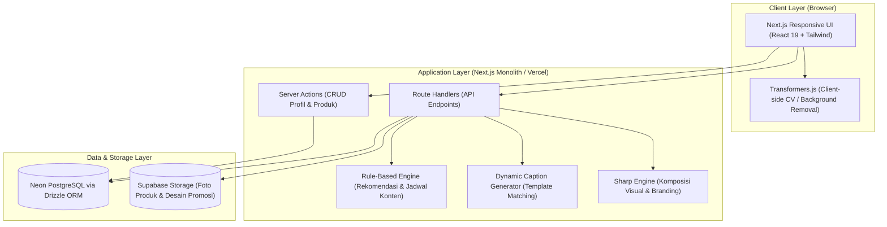
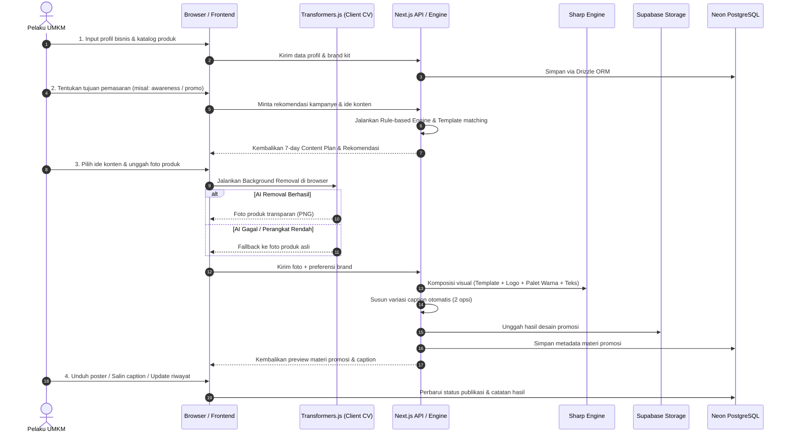

# PRODUCT REQUIREMENTS DOCUMENT (PRD)

## UMKita — Asisten Branding Visual UMKM
**Hackathon MVP — Solusi Cerdas Desain Poster, Motion Video, dan Copywriting untuk Akselerasi Bisnis Lokal**

---

### Deskripsi Produk

**UMKita** adalah platform asisten branding visual terpadu yang memberdayakan pelaku Usaha Mikro, Kecil, dan Menengah (UMKM) untuk merancang identitas visual profesional, memproduksi materi promosi (poster 1:1 dan video vertikal 9:16), serta menyusun strategi konten harian tanpa memerlukan keahlian desain grafis maupun anggaran agensi yang mahal.

Dokumen ini dirancang sebagai acuan teknis hackathon 24 jam FIRETECH 2026 di Telkom AI Center Padang. Sistem mengombinasikan:
1. **AI Computer Vision (WASM):** Ekstraksi dan penghapusan latar belakang foto produk secara lokal di peramban pengguna.
2. **AI Color Harmony Engine:** Analisis warna alami produk makanan untuk menghasilkan palet visual yang serasi secara otomatis.
3. **Katalog 6 Preset Gaya Branding:** *Rustic Minang*, *Claymorphism*, *Editorial Magazine*, *Clean Minimalist*, *Bold Punch Promo*, dan *Nostalgia Vintage*.
4. **Sharp Visual Compositor:** Penggabungan foto produk, logo, efek bayangan jatuh alami (*contact drop shadow*), dan elemen grafis menjadi poster 1080×1080 px.
5. **In-Browser Motion Video Studio:** Generator video animasi promosi vertikal 9:16 (5–10 detik) berbasis HTML5 Canvas dan MediaRecorder API untuk TikTok dan Instagram Reels.
6. **Hybrid Generative Copywriting:** Pemanfaatan *Google Gemini 1.5 Flash (Free Tier)* untuk racikan caption cerdas dan kalender 7 hari, dengan sistem *fallback* template modular jika koneksi terputus.

# 1. Problem & Users

## 1.1 Problem Statement

Banyak pelaku UMKM memiliki keterbatasan pengetahuan, waktu, dan sumber daya untuk menjalankan pemasaran digital secara efektif. Akibatnya, mereka kesulitan menentukan strategi promosi, membuat materi pemasaran yang menarik, serta menjaga konsistensi konten untuk memperkenalkan dan memasarkan produknya kepada calon konsumen.

## 1.2 Target Users

Target utama aplikasi adalah pelaku Usaha Mikro, Kecil, dan Menengah (UMKM) yang ingin mengembangkan pemasaran produknya melalui platform digital, tetapi memiliki keterbatasan sumber daya dalam mengelola aktivitas pemasaran.

Karakteristik target pengguna:

- Pemilik atau pengelola UMKM yang menjalankan usaha secara mandiri atau dengan tim kecil.
- Memasarkan produk melalui media sosial seperti Instagram, WhatsApp, dan platform digital lainnya.
- Belum memiliki tenaga khusus di bidang pemasaran atau desain grafis.
- Memiliki keterbatasan waktu dan biaya untuk membuat materi promosi.
- Membutuhkan panduan sederhana untuk menentukan ide dan aktivitas pemasaran.

Fokus demonstrasi awal diarahkan pada UMKM kuliner, khususnya produk makanan ringan dan oleh-oleh khas Sumatera Barat. Namun, sistem tetap dirancang agar dapat digunakan oleh kategori UMKM lainnya.

## 1.3 User Needs / Pain Points

1. Kesulitan menentukan arah pemasaran. Pelaku UMKM belum memahami jenis promosi, pesan, dan konten yang sesuai dengan produk serta target konsumennya.
2. Keterbatasan dalam membuat materi promosi. Pelaku UMKM kesulitan menghasilkan foto produk, desain promosi, dan caption yang menarik tanpa kemampuan desain maupun copywriting.
3. Kesulitan menjaga konsistensi pemasaran. Pelaku UMKM sering tidak memiliki perencanaan konten yang terstruktur sehingga aktivitas promosi dilakukan secara tidak teratur.
4. Tidak memiliki dokumentasi aktivitas pemasaran. Pelaku UMKM kesulitan mengingat konten dan promosi yang pernah dilakukan serta mencatat hasil aktivitas tersebut.

## 1.4 Project Goal

Mengembangkan platform pendamping pemasaran digital yang membantu UMKM merencanakan aktivitas promosi, menghasilkan materi pemasaran sesuai karakteristik bisnis, dan mengelola konten secara lebih mudah serta konsisten.

Aplikasi diharapkan dapat mengurangi hambatan biaya, waktu, dan keterampilan yang selama ini membatasi UMKM dalam memanfaatkan pemasaran digital.

# 2. Product Requirements

## 2.1 Functional Requirements

Functional Requirements menjelaskan kemampuan yang harus tersedia pada sistem berdasarkan kebutuhan pengguna.

### A. Account & Business Management

| ID    | Functional Requirement                                                                                                         |
| ----- | ------------------------------------------------------------------------------------------------------------------------------ |
| FR-01 | Pengguna dapat masuk ke aplikasi melalui mekanisme autentikasi yang disediakan.                                                |
| FR-02 | Pengguna dapat membuat dan mengelola profil usaha yang berisi nama, kategori, deskripsi, lokasi, dan informasi bisnis lainnya. |
| FR-03 | Pengguna dapat menambahkan, melihat, mengubah, dan menghapus data produk.                                                      |
| FR-04 | Pengguna dapat mengatur identitas brand berupa logo, warna, gaya visual, dan karakter komunikasi.                              |

### B. Marketing Assistant

| ID    | Functional Requirement                                                                                                                       |
| ----- | -------------------------------------------------------------------------------------------------------------------------------------------- |
| FR-05 | Pengguna dapat memilih tujuan pemasaran, seperti memperkenalkan produk, meningkatkan brand awareness, atau menjalankan promosi.              |
| FR-06 | Sistem dapat menghasilkan rekomendasi aktivitas pemasaran berdasarkan profil usaha, informasi produk, target konsumen, dan tujuan pemasaran. |
| FR-07 | Sistem dapat memberikan rekomendasi pesan utama, jenis konten, serta produk yang relevan dengan tujuan pemasaran.                            |
| FR-08 | Pengguna dapat melihat dan memilih rekomendasi pemasaran yang ingin dijalankan.                                                              |

### C. Content Planner

| ID    | Functional Requirement                                                                                        |
| ----- | ------------------------------------------------------------------------------------------------------------- |
| FR-09 | Sistem dapat menghasilkan rencana konten selama tujuh hari berdasarkan tujuan pemasaran dan informasi bisnis. |
| FR-10 | Setiap ide konten menampilkan topik, jenis konten, deskripsi singkat, dan produk yang direkomendasikan.       |
| FR-11 | Pengguna dapat melihat, mengubah, dan mengelola ide konten dalam rencana mingguan.                            |
| FR-12 | Pengguna dapat memperbarui status konten menjadi belum dibuat, sudah dibuat, atau sudah dipublikasikan.       |

### D. AI Visual & Motion Studio

| ID    | Functional Requirement                                                                                                              |
| ----- | ----------------------------------------------------------------------------------------------------------------------------------- |
| FR-13 | Pengguna dapat memilih ide konten atau katalog produk yang akan diproduksi menjadi materi promosi.                                  |
| FR-14 | Pengguna dapat mengunggah foto produk dari kamera perangkat untuk diproses oleh sistem.                                             |
| FR-15 | Sistem dapat menghapus latar belakang foto produk secara otomatis menggunakan model Computer Vision berbasis peramban (WASM).       |
| FR-16 | Sistem dapat menganalisis dan mengekstrak harmoni warna dominan dari foto produk untuk disinkronkan ke palet template desain.       |
| FR-17 | Pengguna dapat memilih salah satu dari 6 Preset Gaya Branding (Rustic Minang, Claymorphism, Magazine, Minimalist, Promo, Vintage).|
| FR-18 | Sistem dapat merakit poster promosi resolusi tinggi (1080x1080 px) lengkap dengan logo usaha, lencana harga, dan bayangan alami.    |
| FR-19 | Sistem dapat menghasilkan video animasi promosi vertikal 9:16 (Motion Reel 5-10 detik) siap tayang untuk TikTok & Instagram Reels.  |
| FR-20 | Sistem dapat menghasilkan 2 variasi caption promosi persuasif via Gemini Flash dengan opsi salin 1-klik dan tagar lokal Minang.     |
| FR-21 | Pengguna dapat melihat preview instan, mengganti preset visual, dan mengunduh berkas poster (PNG) maupun video promosi (WebM/MP4). |

### E. Marketing History

| ID    | Functional Requirement                                                                                                               |
| ----- | ------------------------------------------------------------------------------------------------------------------------------------ |
| FR-20 | Sistem dapat menyimpan riwayat materi promosi yang telah dibuat pengguna.                                                            |
| FR-21 | Pengguna dapat melihat kembali materi promosi berdasarkan waktu pembuatan dan informasi produk.                                      |
| FR-22 | Pengguna dapat mencatat aktivitas publikasi dan hasil promosi secara manual, seperti jumlah pesan masuk atau pesanan yang diperoleh. |

### F. System Feedback

| ID    | Functional Requirement                                                                                                             |
| ----- | ---------------------------------------------------------------------------------------------------------------------------------- |
| FR-23 | Sistem menampilkan pesan validasi apabila informasi yang dimasukkan pengguna belum lengkap atau tidak sesuai.                      |
| FR-24 | Sistem menampilkan indikator proses ketika sistem sedang menghasilkan rekomendasi atau memproses gambar.                           |
| FR-25 | Sistem memberikan informasi apabila proses gagal dan menyediakan pilihan untuk mencoba kembali atau menggunakan metode alternatif. |

## 2.2 Non-functional Requirements

| ID     | Non-functional Requirement                                                                                                                                                              |
| ------ | --------------------------------------------------------------------------------------------------------------------------------------------------------------------------------------- |
| NFR-01 | Aplikasi berbasis web dan dapat diakses melalui browser pada perangkat desktop maupun mobile.                                                                                           |
| NFR-02 | Halaman utama dan halaman dashboard ditargetkan dapat ditampilkan dalam waktu maksimal 3 detik pada kondisi jaringan normal, tidak termasuk proses pemuatan model AI.                   |
| NFR-03 | Antarmuka menggunakan bahasa Indonesia dengan navigasi dan istilah yang mudah dipahami oleh pelaku UMKM.                                                                                |
| NFR-04 | Aplikasi harus memiliki tampilan responsif dan dapat menyesuaikan ukuran layar perangkat.                                                                                               |
| NFR-05 | Data bisnis dan riwayat konten hanya dapat diakses oleh pengguna yang memiliki otorisasi terhadap data tersebut.                                                                        |
| NFR-06 | Informasi sensitif seperti kredensial dan konfigurasi layanan disimpan melalui environment variables, bukan ditulis langsung di source code.                                            |
| NFR-07 | Sistem harus menyediakan validasi terhadap format, ukuran, dan tipe file gambar yang diunggah.                                                                                          |
| NFR-08 | Kegagalan pemrosesan AI tidak boleh menyebabkan seluruh fungsi pembuatan materi promosi tidak dapat digunakan. Sistem harus menyediakan alternatif pemrosesan tanpa background removal. |
| NFR-09 | Sistem harus menggunakan struktur kode modular agar fitur dapat dikembangkan dan dipelihara dengan lebih mudah.                                                                         |
| NFR-10 | Aplikasi dapat diakses melalui deployment berbasis cloud.                                                                                                                               |

## 2.3 Core Features & Screen Inventory

Sistem UMKita berpusat pada delapan layar utama (*Screen Inventory*) yang mencakup seluruh perjalanan pemasaran digital UMKM:

| ID Layar | Nama Layar | Rute URL | Fitur Inti & Nilai Manfaat |
| :--- | :--- | :--- | :--- |
| **SCR-01** | Autentikasi & Akun Demo | `/login` | Akses instan bagi pengguna via email/password atau 1-klik akun demo interaktif. |
| **SCR-02** | Onboarding Usaha & Brand Kit | `/onboarding` | Panduan langkah demi langkah mendaftarkan profil usaha dan memilih palet warna brand. |
| **SCR-03** | Dashboard Utama UMKM | `/dashboard` | Pusat kendali visual: sapaan ramah, status konten hari ini, dan aksi cepat (*quick action*). |
| **SCR-04** | Katalog & Manajemen Produk | `/products` | Tambah, ubah, dan kelola menu kuliner, harga, foto, serta keunggulan produk. |
| **SCR-05** | Asisten Pemasaran | `/marketing/assistant` | Membantu menentukan tujuan kampanye (Peluncuran Baru, Diskon, Edukasi, Awareness). |
| **SCR-06** | Kalender Konten 7 Hari | `/marketing/planner` | Jadwal konten terstruktur selama satu minggu penuh hasil racikan Rule-based Engine. |
| **SCR-07** | AI Content Studio | `/studio` | Eksekusi materi promosi: AI background removal di browser, template Sharp, & caption. |
| **SCR-08** | Galeri Aset Brand & Arsip Desain | `/history` | Galeri penyimpanan seluruh poster visual dan video motion reel yang telah dibuat, siap diunduh ulang atau dibagikan kapan saja. |

Catatan: Studio Kreatif AI menggabungkan Computer Vision berbasis WebAssembly (WASM) untuk penghapusan latar belakang seketika di peramban, algoritma AI Color Harmony untuk ekstraksi pigmen kuliner, engine Motion Reel 9:16 (HTML5 Canvas 60 FPS), serta Google Gemini 1.5 Flash untuk asisten copywriting multimodal (didukung fallback cerdas lokal jika offline).

## 2.4 User Flow & Happy Flow

Alur interaksi pengguna di dalam UMKita dirancang sangat ringkas, intuitif, dan tidak berbelit-belit agar pelaku UMKM yang awam teknologi dapat menghasilkan materi promosi profesional dalam hitungan menit tanpa terbebani tugas pencatatan yang rumit.

### 2.4.1 Happy Flow (4 Fase Utama Alur Ideal)

Alur linear dari pertama kali membuka aplikasi hingga materi promosi siap tayang di media sosial:

```
[Fase 1: Onboarding]
Isi profil toko & tentukan Brand Kit (Warna & Gaya Minang)
       ↓
[Fase 2: Perencanaan Ide]
Pilih tema promosi & generate kalender konten 7 hari
       ↓
[Fase 3: Studio Kreatif AI]
Hapus background foto produk, terapkan 6 preset & AI Color Harmony
       ↓
[Fase 4: Distribusi & Galeri Aset]
Unduh poster 1:1, ekspor video 9:16, 1-klik share ke medsos, dan simpan ke Galeri Aset Toko
```

Atau dalam bentuk rantai tahapan ringkas:
**Buka Aplikasi** → **Login Google / Demo** → **Onboarding Usaha & Brand Kit** → **Dashboard** → **Pilih Goal & Kalender 7 Hari** → **Masuk Studio Kreatif AI (WASM Cutout + 6 Preset + AI Color Harmony)** → **Ekspor Poster 1:1 & Video Reel 9:16** → **Salin Caption Gemini** → **1-Click Share ke Medsos** → **Tersimpan Otomatis di Galeri Aset Brand**.

### 2.4.2 Penjelasan Runtut Alur Penggunaan (Step-by-Step)

1. **Autentikasi (Google Auth / Demo Mode):** Pengguna masuk secara instan menggunakan akun Google (*Single Sign-On*) atau tombol 1-Click Demo tanpa perlu mengingat kata sandi baru.
2. **Business & Brand Onboarding:** Pengguna melengkapi identitas usaha kuliner (nama toko, kategori kuliner khas) dan memilih palet warna *Brand Kit* utama yang mencerminkan karakter bisnisnya.
3. **Dashboard Utama:** Menampilkan sapaan personal hangat, ringkasan katalog produk, dan kartu rekomendasi aksi konten terbaik untuk hari ini.
4. **Marketing Assistant & Kalender 7 Hari:** Pengguna memilih tujuan kampanye (misal: *Promo Diskon / Flash Sale*). Sistem menyusun jadwal konten terstruktur selama 7 hari lengkap dengan tema dan sudut pandang narasi.
5. **Akses AI Content Studio:** Pengguna memilih ide konten hari ini, lalu diarahkan ke studio kreatif dengan data produk yang terisi secara otomatis.
6. **Pemrosesan Citra Cerdas (Client CV):** Pengguna mengunggah foto produk kuliner mentah. AI (*Transformers.js / WASM*) langsung memotong latar belakang secara lokal, cepat, dan hemat kuota internet.
7. **Komposisi 6 Preset & AI Color Harmony:** Pengguna memilih salah satu dari 6 preset visual khas Minang (*Rustic Minang, Claymorphism, Editorial, Clean, Bold Promo, Vintage*) dan mengaktifkan *AI Color Harmony* agar warna latar selaras dengan pigmen makanan.
8. **Motion Reel Video 9:16 & Caption Gemini:** Sistem merender video vertikal animasi 60 FPS untuk TikTok/Reels via HTML5 Canvas, sekaligus menuliskan narasi caption persuasif via Google Gemini 1.5 Flash.
9. **Pratinjau, Unduh & Bagikan (Web Share API):** Pengguna meninjau hasil, mengunduh poster (PNG) atau video (WebM), atau membagikannya langsung ke aplikasi media sosial perangkat dengan satu klik.
10. **Galeri Aset Brand & Arsip Desain:** Sistem menyimpan seluruh karya visual ke dalam galeri aset toko. Status jadwal di kalender otomatis tercentang *"Sudah Diterbitkan"*, dan aset dapat diakses kembali sewaktu-waktu tanpa perlu desain ulang.

### 2.4.3 Alur Alternatif (Jalur Cepat / Express Studio Flow)

Bagi pelaku UMKM yang sedang terburu-buru dan hanya ingin membuat materi visual secara instan tanpa melalui perencanaan kalender:
**Dashboard** → **Buka AI Studio Langsung** → **Unggah Foto** → **Pilih Preset & Harmonisasi Warna** → **Ekspor Poster / Video & Selesai!**

## 2.5 Data Requirements

Data utama yang digunakan dan disimpan oleh aplikasi meliputi:

| Data / Entity            | Key Information                                                                               | Purpose                                                             |
| ------------------------ | --------------------------------------------------------------------------------------------- | ------------------------------------------------------------------- |
| User                     | ID, email, password hash / google_id, created_at                                              | Menyimpan identitas dan autentikasi pengguna.                       |
| Business                 | ID, user_id, business_name, category, description, location, target_audience                  | Menyimpan informasi dasar usaha untuk personalisasi rekomendasi.    |
| Product                  | ID, business_id, product_name, description, price, advantages, image_url                      | Menyimpan katalog produk yang akan dipromosikan.                    |
| Brand Kit                | ID, business_id, logo_url, primary_color, secondary_color, visual_style, communication_tone   | Menyimpan identitas brand untuk menjaga konsistensi materi promosi. |
| Marketing Goal           | ID, business_id, goal_type, target_product, target_audience, created_at                       | Menyimpan tujuan pemasaran yang dipilih pengguna.                   |
| Marketing Recommendation | ID, goal_id, campaign_idea, key_message, content_type, recommendation_details                 | Menyimpan hasil rekomendasi aktivitas pemasaran.                    |
| Content Plan             | ID, goal_id, date, topic, content_type, description, product_id, status                       | Menyimpan rencana konten mingguan.                                  |
| Marketing Content        | ID, product_id, content_plan_id, original_image_url, processed_image_url, video_url, caption  | Menyimpan hasil materi promosi (poster & video 9:16) buatan AI.    |
| Brand Asset & Activity   | ID, content_id, format (POSTER/VIDEO), download_count, share_channel, publication_status      | Menyimpan arsip galeri aset brand dan status publikasi konten.      |

Relasi data utama:

- Satu User memiliki satu Business pada versi MVP.
- Satu Business dapat memiliki banyak Product.
- Satu Business memiliki satu Brand Kit aktif.
- Satu Business dapat memiliki banyak Marketing Goal.
- Satu Marketing Goal dapat menghasilkan banyak Marketing Recommendation dan Content Plan.
- Satu Content Plan dapat dihubungkan dengan Marketing Content.
- Satu Marketing Content dapat memiliki satu catatan Marketing Activity.

Catatan: Foto asli dan hasil pemrosesan gambar disimpan pada object storage, sedangkan database menyimpan URL dan metadata file. Hasil rekomendasi dan rencana konten disimpan agar pengguna dapat melihat kembali hasil sebelumnya.

## 2.6 Constraints & Assumptions

### Constraints

1. Pengembangan prototype dirancang dalam batas waktu 24 jam hackathon.
2. Aplikasi dikembangkan sebagai web application responsif menggunakan Next.js 15/16.
3. Fitur Generative AI menggunakan Google Gemini 1.5 Flash (Free Tier tanpa biaya kartu kredit) dengan mekanisme Smart Local Fallback otomatis jika perangkat offline.
4. Pemrosesan background removal dijalankan langsung di sisi peramban pengguna (*client-side WASM*) untuk menghemat kuota dan meminimalkan beban server.
5. Pembuatan video vertikal 9:16 diproses secara instan di peramban menggunakan HTML5 Canvas 60 FPS dan MediaRecorder API tanpa memerlukan GPU server mahal.
6. Penyimpanan data relasional menggunakan Neon PostgreSQL via Drizzle ORM, sedangkan aset gambar menggunakan Supabase Storage.
7. Sistem menggunakan 6 pilihan preset gaya branding visual khas Minangkabau pada versi MVP.
8. Sistem fokus pada kreasi materi branding visual; tidak mencakup sistem kasir/pencatatan akuntansi penjualan (bukan POS).

### Assumptions

1. Pengguna memiliki foto produk kuliner mentah (foto smartphone) yang dapat diunggah ke aplikasi.
2. Pengguna mengakses aplikasi melalui browser modern (Chrome / Edge / Safari).
3. Pengguna memiliki aplikasi media sosial (Instagram, TikTok, atau WhatsApp) untuk memublikasikan materi promosi hasil ekspor.
4. Pelaku UMKM membutuhkan solusi visual instan tanpa harus mempelajari software desain grafis profesional yang rumit.

### Kapabilitas Cerdas Studio Kreatif AI

Untuk memberikan inovasi yang terukur dan berdampak nyata bagi UMKM:

1. **AI Vision & Background Removal:** Memisahkan objek makanan dari latar belakang dapur/kotor secara lokal via WASM dalam hitungan detik.
2. **AI Color Harmony Extractor:** Mengekstrak palet warna dominan makanan (misal: merah cabai Sanjai, cokelat karamel Rendang, atau aroma kopi) dan menyelaraskan gradien poster secara harmonis.
3. **Katalog 6 Preset Gaya Branding Minang:** *Rustic Minang*, *Claymorphism 3D*, *Editorial Magazine*, *Clean Minimalist*, *Bold Punch Promo*, dan *Nostalgia Vintage*.
4. **In-Browser Motion Video Studio (9:16):** Merender video vertikal animasi 60 FPS siap tayang di TikTok dan Reels langsung dari peramban dengan efek *Ken Burns slow zoom* dan partikel rempah mengambang.
5. **Multimodal Copywriting:** Menghasilkan *hook*, narasi caption, dan tagar dalam 2 mode (Storytelling Minang vs Hard Selling Promo) menggunakan Google Gemini 1.5 Flash.

## 2.7 Success Criteria

Keberhasilan prototype dinilai melalui indikator berikut:

1. **Setup Cepat:** Pengguna dapat menyelesaikan onboarding identitas toko dan brand kit warna dalam waktu kurang dari 2 menit.
2. **Perencanaan Mingguan Otomatis:** Sistem sukses menyusun kalender konten 7 hari tematik yang selaras dengan tujuan kampanye.
3. **Studio Visual Instan:** Pengguna dapat menghapus background foto, memilih preset branding, dan mengekstrak warna makanan secara mulus.
4. **Multi-Format Export:** Sistem sukses mengekspor poster resolusi tinggi (PNG 1:1) dan video vertikal (WebM 9:16) dalam waktu kurang dari 10 detik.
5. **Distribusi Mudah:** Pengguna dapat menyalin caption atau membagikan langsung (*1-click share*) ke WhatsApp/Instagram, serta menyimpannya ke Galeri Aset Brand.

# 3. Scope

## 3.1 In Scope

Fitur dan aktivitas yang termasuk dalam pengembangan MVP:

| No. | Fitur / Aktivitas              | Batasan Implementasi                                                            |
| --- | ------------------------------ | ------------------------------------------------------------------------------- |
| 1   | User Authentication            | Login via Google OAuth 2.0 dan 1-Click Akun Demo interaktif.                    |
| 2   | Business & Brand Kit Setup     | Profil usaha kuliner, pilihan kategori, dan palet warna Brand Kit.               |
| 3   | Product Catalog Management     | Tambah, lihat, dan kelola menu kuliner, harga, serta foto produk.              |
| 4   | Marketing Assistant            | Pemilihan 4 tujuan kampanye (Promo Diskon, Peluncuran, Awareness, Edukasi).     |
| 5   | Content Planner 7 Hari         | Jadwal konten mingguan tematik terstruktur dengan status publikasi.             |
| 6   | AI Background Removal (WASM)   | Pemisahan objek makanan dari latar belakang langsung di browser.                |
| 7   | 6 Preset Gaya Branding Minang  | *Rustic Minang, Claymorphism, Editorial, Clean, Bold Promo, Nostalgia Vintage*. |
| 8   | AI Color Harmony Extractor     | Harmonisasi warna template dengan pigmen alami foto makanan.                    |
| 9   | In-Browser Motion Video Studio | Generator video vertikal 9:16 (60 FPS) berbasis HTML5 Canvas & MediaRecorder.   |
| 10  | Smart Copywriting Assistant    | Generator caption multimodal via Gemini 1.5 Flash + Local Fallback cerdas.      |
| 11  | 1-Click Multi-Format Export    | Unduh poster PNG 1:1, unduh video WebM 9:16, dan Web Share API ke medsos.       |
| 12  | Galeri Aset Brand & Arsip      | Penyimpanan karya visual siap pakai (*reusable assets*) untuk toko UMKM.        |

## 3.2 Out of Scope

Fitur berikut sengaja tidak dimasukkan ke dalam MVP untuk menjaga fokus dan efektivitas kompetisi 24 jam:

1. Sistem kasir, pencatatan transaksi manual, dan akuntansi penjualan (karena UMKita adalah asisten visual branding, bukan Point of Sales/POS).
2. Auto-posting langsung ke API media sosial (Meta Graph API / TikTok API berbayar dan memerlukan verifikasi bisnis rumit).
3. Model difusi video berbasis GPU server berat (seperti Sora, Runway, atau MoneyPrinterTurbo) untuk mencegah risiko downtime saat presentasi juri.
4. Pengelolaan multi-cabang atau waralaba dalam satu akun.
5. Integrasi pembayaran gateway atau checkout e-commerce.

# 4. Arsitektur Sistem

## 4.1 Architecture Overview

Aplikasi menggunakan arsitektur monolithic web application dengan Next.js sebagai frontend sekaligus backend. Seluruh fitur utama dikelola dalam satu project agar proses integrasi dan deployment lebih sederhana selama hackathon.

Arsitektur terdiri atas empat lapisan utama:

1. Presentation Layer: Menangani antarmuka dan interaksi pengguna.
2. Application Layer: Menangani business logic, rekomendasi pemasaran, pengelolaan konten, dan pemrosesan gambar.
3. Data Layer: Menangani penyimpanan data bisnis dan file gambar.
4. Deployment Layer: Menangani hosting dan deployment aplikasi.

## 4.2 Technology Stack

| Layer                | Technology                              | Purpose                                              |
| -------------------- | --------------------------------------- | ---------------------------------------------------- |
| Frontend             | Next.js 16 App Router                   | Framework utama aplikasi web.                        |
| UI Library           | React 19                                | Membangun komponen antarmuka interaktif.             |
| Programming Language | TypeScript                              | Menjaga konsistensi tipe data.                       |
| Styling              | Tailwind CSS                            | Mengatur tampilan dan responsivitas antarmuka.       |
| Backend              | Next.js Route Handlers & Server Actions | Menangani request dan business logic.                |
| ORM                  | Drizzle ORM                             | Menghubungkan aplikasi dengan database.              |
| Database             | Neon PostgreSQL                         | Menyimpan data pengguna, bisnis, produk, dan konten. |
| Object Storage       | Supabase Storage                        | Menyimpan foto produk dan hasil desain.              |
| Computer Vision      | Transformers.js / @imgly-bg-removal     | Ekstraksi background removal produk di sisi klien.   |
| Generative AI        | Google Gemini 1.5 Flash API (Free Tier) | Creative Director untuk caption & analisa visual.    |
| Color Intelligence   | ColorThief / K-Means                    | Ekstraksi harmoni warna alami dari foto produk.      |
| Image Compositor     | Sharp                                   | Render layer poster, drop shadow, & branding visual. |
| Video Studio Engine  | HTML5 Canvas & MediaRecorder API        | Render video promosi vertikal 9:16 (Motion Reel).    |
| Deployment           | Vercel                                  | Hosting dan deployment aplikasi.                     |
| Version Control      | GitHub                                  | Mengelola source code dan kolaborasi tim.            |

## 4.3 System Architecture Diagram

Berikut gambaran hubungan antara komponen sistem:



## 4.4 Component Architecture

### A. Frontend Layer

Frontend menjadi tempat pengguna menjalankan seluruh aktivitas pemasaran.

Komponen utamanya:

- Dashboard: Menampilkan ringkasan bisnis, aktivitas pemasaran, dan rekomendasi.
- Business Profile: Mengelola informasi usaha dan produk.
- Marketing Assistant: Menampilkan tujuan serta rekomendasi pemasaran.
- Content Planner: Menampilkan rencana konten mingguan.
- AI Content Studio: Menangani unggah gambar, preview, dan pembuatan materi promosi.
- Marketing History: Menampilkan konten yang telah dibuat dan aktivitas pemasaran.

### B. Application Layer

Backend menangani proses bisnis dan komunikasi dengan layanan penyimpanan.

Komponen utamanya:

- Marketing Recommendation Engine: Menghasilkan rekomendasi berdasarkan aturan dan informasi bisnis.
- Caption Generator: Menghasilkan caption berdasarkan template, produk, tujuan promosi, dan gaya komunikasi brand.
- Image Processing Module: Menangani pengolahan gambar dan komposisi materi promosi.
- Content Management: Menangani penyimpanan, pembaruan, dan pengambilan data konten.

Pembagian tanggung jawab:

- Server Actions digunakan untuk operasi data sederhana seperti pengelolaan profil dan produk.
- Route Handlers digunakan untuk proses yang membutuhkan endpoint khusus, seperti pemrosesan gambar dan pembuatan konten.

### C. Data Layer

Terdiri atas dua layanan penyimpanan:

Neon PostgreSQL

Menyimpan data terstruktur seperti:

- User dan Business.
- Product dan Brand Kit.
- Marketing Goal dan Recommendation.
- Content Plan dan Marketing Content.
- Marketing Activity.

Supabase Storage

Menyimpan file:

- Logo usaha.
- Foto asli produk.
- Foto produk hasil background removal.
- Gambar promosi yang telah dihasilkan.

Database hanya menyimpan informasi metadata dan alamat file, bukan menyimpan file gambar secara langsung.

### D. AI & Image Processing Layer

Lapisan ini memiliki dua proses yang berbeda.

1\. Background Removal menggunakan Transformers.js

Proses dijalankan pada browser pengguna menggunakan model computer vision yang telah dilatih sebelumnya.

Alur:

```
Upload Product Image
        |
        v
Load Computer Vision Model
        |
        v
Image Segmentation
        |
        v
Separate Product & Background
        |
        v
Transparent PNG
```

2\. Image Compositing menggunakan Sharp

Setelah foto produk memiliki background transparan, sistem menggabungkannya dengan elemen visual brand.

Alur:

```
Transparent Product Image
          +
Brand Template
          +
Background & Decorations
          +
Product Information
          |
          v
    Sharp Compositing
          |
          v
 Promotional Image
```

Jika background removal gagal, sistem tetap dapat membuat materi promosi menggunakan foto asli dengan template alternatif.

## 4.5 Main System Process

Alur proses utama dari sisi sistem secara menyeluruh (*end-to-end*):



## 4.6 Deployment Architecture

Aplikasi akan di-deploy menggunakan Vercel dan terhubung dengan repository GitHub.

Tahapan deployment:

1. Developer mengembangkan aplikasi secara lokal.
2. Source code dikelola menggunakan Git dan GitHub.
3. Repository dihubungkan dengan Vercel.
4. Environment variables dikonfigurasi pada Vercel.
5. Vercel melakukan build dan deployment aplikasi.
6. Aplikasi dapat diakses melalui URL deployment.

## 4.7 Technical Constraints

Beberapa hal yang perlu diperhatikan dalam implementasi arsitektur:

- Model Transformers.js perlu dimuat sebelum background removal dapat digunakan. Ukuran model dan waktu pemuatan dapat memengaruhi pengalaman pengguna.
- Proses background removal dapat bergantung pada kemampuan browser dan perangkat pengguna. Sistem perlu menyediakan fallback.
- Sharp dijalankan pada lingkungan Node.js, sehingga endpoint pemrosesan gambar perlu menggunakan Node.js runtime.
- File gambar perlu dibatasi ukuran dan formatnya untuk menghindari beban pemrosesan yang terlalu besar.
- Neon dan Supabase membutuhkan konfigurasi koneksi dan environment variables yang benar.
- Sistem tidak bergantung pada layanan LLM eksternal.

## Ringkasan Keputusan Produk

Berikut keputusan yang menjadi baseline pengembangan:

| Aspek                  | Keputusan                                                                                                                             |
| ---------------------- | ------------------------------------------------------------------------------------------------------------------------------------- |
| Product Name & Positioning | **UMKita** — Digital Marketing Enabler for UMKM                                                                                  |
| Target User            | Pelaku UMKM, fokus demonstrasi UMKM kuliner                                                                                           |
| Main Value             | Membantu UMKM merencanakan dan menjalankan pemasaran digital secara lebih mudah                                                       |
| Core Features          | Business & Brand Profile, Marketing Assistant, Content Planner, AI Content Studio, Marketing History, Content Distribution & Tracking |
| AI Capability          | Computer Vision untuk background removal                                                                                              |
| Marketing Intelligence | Rule-based recommendation                                                                                                             |
| Caption Generation     | Template-based generation                                                                                                             |
| Platform               | Web Application                                                                                                                       |
| Architecture           | Next.js Monolithic Application                                                                                                        |
| Database               | Neon PostgreSQL                                                                                                                       |
| Storage                | Supabase Storage                                                                                                                      |
| Deployment             | Vercel                                                                                                                                |
| Development Time       | 24 jam                                                                                                                                |

Catatan penting untuk tim: PRD ini adalah spesifikasi produk, bukan berarti seluruh requirement harus diwujudkan dengan kompleksitas penuh. Prioritas implementasi tetap pada satu perjalanan pengguna yang utuh: pengguna memasukkan informasi bisnis, memperoleh rekomendasi pemasaran, membuat rencana konten, menghasilkan materi promosi, dan menyimpan hasilnya.

Untuk hackathon, lebih baik lima sampai enam fitur inti berjalan dengan baik dalam satu alur daripada banyak fitur tersedia tetapi tidak terintegrasi.

# 5. Risiko Teknis & Strategi Mitigasi

| No. | Potensi Risiko | Tingkat Dampak | Probabilitas | Strategi Mitigasi |
| :--- | :--- | :--- | :--- | :--- |
| 1 | **Pemuatan model Transformers.js berat di browser client** | Tinggi | Sedang | Sediakan mekanisme *graceful fallback*: jika browser gagal memuat model dalam 10 detik, sistem langsung menawarkan template berbingkai dengan foto asli tanpa background removal. |
| 2 | **Beban memori saat render gambar Sharp di backend** | Sedang | Rendah | Batasi ukuran resolusi unggahan gambar maks. 5 MB (2048x2048 px) dan pastikan Route Handler Sharp dijalankan pada standard Node.js runtime dengan memori memadai di Vercel. |
| 3 | **Hasil caption dan rekomendasi terkesan monoton / kaku** | Rendah | Sedang | Rancang variasi template copywriting modular dengan slot dinamis (nama produk, keunggulan, call-to-action, tagar lokal) yang disesuaikan dengan tone brand kit. |
| 4 | **Kecepatan unggah lambat pada jaringan internet UMKM** | Sedang | Tinggi | Terapkan kompresi gambar di sisi klien (*client-side canvas resize*) sebelum berkas dikirim ke Supabase Storage. |
| 5 | **Alokasi waktu hackathon 24 jam sangat terbatas** | Tinggi | Sedang | Fokus pada satu *golden path* utama: Onboarding Profil -> Rekomendasi Pemasaran -> AI Visual & Caption Studio -> Unduh & Riwayat. |