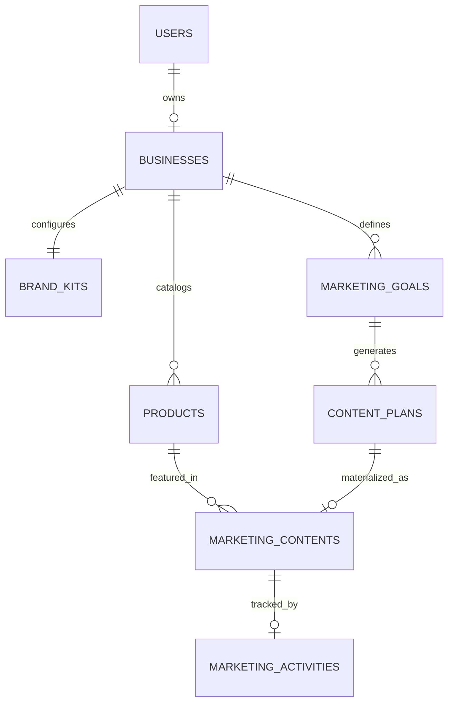
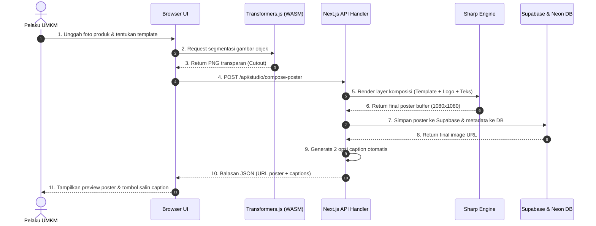
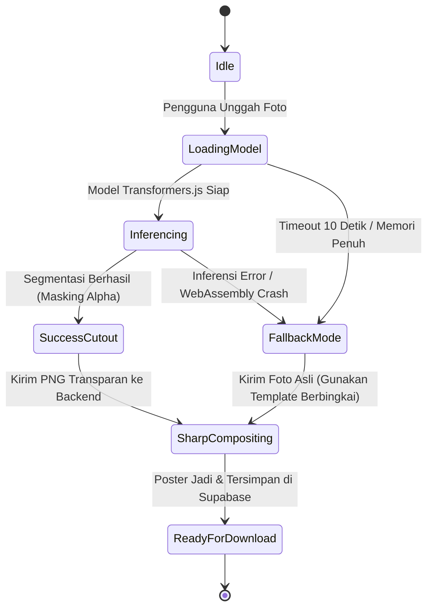

# SOFTWARE REQUIREMENTS SPECIFICATION (SRS)

## UMKita — Asisten Branding Visual UMKM
**Document Version:** 1.2 (Final Approved Baseline)  
**Target Event:** FIRETECH Hackathon 2026 (Telkom AI Center Padang, 24-Hour Prototype Scope)  
**Status:** Approved Technical Baseline  

> **Scope update implementasi:** Generator Motion Video 9:16 ditunda atas keputusan produk. Tipe data video dapat dipertahankan untuk kompatibilitas masa depan, tetapi UI, rekomendasi pemasaran, ekspor, dan golden path aktif hanya memproduksi poster PNG serta caption.

---

## 1. Pendahuluan (Introduction)

### 1.1 Tujuan Dokumen (Purpose)
Dokumen *Software Requirements Specification* (SRS) ini merinci spesifikasi teknis, arsitektur data, kontrak antarmuka pemrograman aplikasi (API), serta aturan logika bisnis sistem **UMKita — Asisten Branding Visual UMKM**. Dokumen ini menjadi acuan mutlak bagi tim pengembang (*engineering team*) selama sprint 24 jam FIRETECH Hackathon agar implementasi kode terarah, presisi, dan bebas dari ambiguitas teknis.

### 1.2 Cakupan Produk (Scope)
**UMKita** adalah platform asisten branding visual terpadu berbasis **Next.js 16** yang memadukan Computer Vision, Generative AI multimodal, dan Dynamic Motion Rendering untuk memproduksi materi pemasaran profesional bagi UMKM. Sistem mengintegrasikan:
1. **Client-side Computer Vision (WASM):** Penghapusan latar belakang foto produk secara lokal tanpa membebani server via model *Transformers.js*.
2. **AI Color Harmony Engine:** Analisis dan ekstraksi warna alami dari foto produk makanan menggunakan *ColorThief* untuk menghasilkan palet visual yang harmonis.
3. **Katalog 6 Preset Gaya Branding:** *Rustic Minang*, *Claymorphism*, *Editorial Magazine*, *Clean Minimalist*, *Bold Punch Promo*, dan *Nostalgia Vintage*.
4. **Backend Visual Compositor (Sharp):** Komposisi poster 1080×1080 px dengan efek bayangan jatuh natural (*contact drop shadow*), logo, dan badge promo.
5. **In-Browser Motion Video Studio:** Generator video promosi vertikal 9:16 (5–10 detik) berbasis HTML5 Canvas dan MediaRecorder API untuk TikTok & Reels.
6. **Hybrid Generative Copywriting:** Pemanfaatan *Google Gemini 1.5 Flash API* untuk caption persuasif dan kalender 7 hari dengan *fallback* rule-based offline.
7. **Data Persistence & Tracking:** Penyimpanan basis data relasional via *Neon PostgreSQL (Drizzle ORM)* dan *Supabase Storage*.

### 1.3 Definisi & Istilah Teknis
- **ORM (Object-Relational Mapping):** Lapisan abstraksi kode untuk berinteraksi dengan database SQL menggunakan objek TypeScript yang *type-safe* (Drizzle ORM).
- **Client-Side Inference:** Menjalankan model kecerdasan buatan langsung di mesin/peramban pengguna memanfaatkan WebAssembly (WASM) atau WebGPU tanpa membebani server.
- **Image Compositing:** Proses perakitan beberapa lapisan grafis (latar belakang, foto produk terisolasi, logo, lencana harga, dan teks) menjadi satu berkas gambar utuh (*flattened image*).
- **Brand Kit:** Kumpulan aset dan aturan identitas visual bisnis (warna primer, sekunder, logo, dan gaya komunikasi).
- **Graceful Degradation:** Pola rekayasa perangkat lunak di mana jika fitur mutakhir (AI background removal) gagal, sistem otomatis beralih ke fitur alternatif (*fallback*) tanpa merusak alur kerja pengguna.

---

## 2. Arsitektur Teknis & Antarmuka Sistem (System Interfaces)

### 2.1 Lingkungan Eksekusi & Stack Teknis
- **Frontend / Client Runtime:** React 19, Next.js 16 (App Router), Tailwind CSS v4, Lucide React (ikon).
- **Client AI Engine:** `@xenova/transformers` (model segmentasi gambar `briaai/RMBG-1.4` atau `Xenova/modnet` via WebAssembly/WebGPU).
- **Backend Runtime:** Node.js 20+ LTS (Route Handlers & Server Actions).
- **Backend Image Processor:** `sharp` v0.33+ (Native Node.js binary binding).
- **Database & Data Access:** Neon Serverless PostgreSQL terhubung melalui `@neondatabase/serverless` dan `drizzle-orm`.
- **Media Object Storage:** Supabase Storage bucket (`umkita-media`) via `@supabase/supabase-js`.
- **Skema Validasi:** `zod` untuk validasi formulir dan kontrak payload API.

### 2.2 Diagram Konteks Antarmuka Sistem
```
+-----------------------------------------------------------------------+
|                         CLIENT BROWSER                                |
|  - Next.js UI (React 19 + Tailwind)                                   |
|  - Transformers.js (In-browser WASM Image Segmentation)               |
+-----------------------------------------------------------------------+
            | (HTTPS / JSON / Form-Data)
            v
+-----------------------------------------------------------------------+
|                    NEXT.JS APPLICATION SERVER                         |
|  +--------------------+  +--------------------+  +-----------------+  |
|  | Server Actions     |  | Route Handlers     |  | Sharp Engine    |  |
|  | (CRUD Profile/Prod)|  | (Studio & Compose) |  | (Visual Render) |  |
|  +--------------------+  +--------------------+  +-----------------+  |
|  +--------------------+  +--------------------+                       |
|  | Rule-based Engine  |  | Dynamic Caption Gen|                       |
|  +--------------------+  +--------------------+                       |
+-----------------------------------------------------------------------+
        | (SQL over TLS)                                | (REST / S3)
        v                                               v
+-----------------------+                       +-----------------------+
|   NEON POSTGRESQL     |                       |   SUPABASE STORAGE    |
| (Relational Database) |                       | (Object Image Bucket) |
+-----------------------+                       +-----------------------+
```

### 2.3 Spesifikasi 8 Layar Antarmuka Pengguna (Screen Inventory)
Sistem UMKita terdiri atas 8 layar antarmuka pengguna utama yang saling terhubung dalam satu perjalanan pengguna:

| ID Layar | Nama Layar | Rute URL | Fungsi & Fitur Utama | Komponen UI Kunci |
| :--- | :--- | :--- | :--- | :--- |
| **SCR-01** | Layar Autentikasi & Demo | `/login` | Masuk ke sistem via kredensial atau 1-klik akun demo instan. | Form Login, Tombol 1-Klik Akun Demo, Banner Hero |
| **SCR-02** | Layar Onboarding Usaha | `/onboarding` | Panduan pendaftaran profil bisnis UMKM dan preferensi Brand Kit. | Step Wizard, Form Kategori, Color Picker Swatch |
| **SCR-03** | Layar Dashboard Utama | `/dashboard` | Menampilkan ringkasan status bisnis, rencana hari ini, & metrik cepat. | Kartu Sapaan UMKM, Quick Action Pill, Kalender Mini |
| **SCR-04** | Layar Katalog Produk | `/products` | Manajemen data produk (tambah, lihat, ubah harga, foto, keunggulan). | Grid Kartu Produk Clay, Modal Tambah/Edit, Badge Harga |
| **SCR-05** | Layar Asisten Pemasaran | `/marketing/assistant` | Pemilihan tujuan promosi (Product Launch, Awareness, Promo, Edukasi). | Kartu Pilihan Tujuan 3D, Selector Produk Prioritas |
| **SCR-06** | Layar Kalender Konten 7 Hari | `/marketing/planner` | Visualisasi jadwal konten mingguan hasil olahan Rule Engine. | 7-Day Card Timeline, Chip Jenis Konten, Tombol Buat Konten |
| **SCR-07** | Layar AI Content Studio | `/studio` | Ruang kreasi materi promosi: AI background removal, Sharp, & caption. | Inset Dropzone, Slider Before/After, Preset Template, Copy Box |
| **SCR-08** | Galeri Aset Brand & Arsip Desain | `/history` | Galeri penyimpanan seluruh poster visual & video motion reel yang telah dibuat, siap diunduh ulang atau dibagikan kapan saja. | Galeri Kartu Aset Visual, Tombol Unduh Ulang, Tombol 1-Klik Share Medsos |

---


---

## 3. Kamus Data & Skema Database Detail (Drizzle ORM Schema)

Skema database dirancang ternormalisasi tingkat ketiga (3NF) dengan indeks relasional untuk performa optimal.

### 3.1 Entity Relationship Diagram (ERD)


### 3.2 Spesifikasi Detail Tabel

#### A. Tabel `users`
Menyimpan kredensial otentikasi pemilik usaha.

| Nama Kolom | Tipe Data (Postgres) | Constraint | Keterangan |
| :--- | :--- | :--- | :--- |
| `id` | `UUID` | PK, Default `gen_random_uuid()` | Pengenal unik pengguna |
| `email` | `VARCHAR(255)` | NOT NULL, UNIQUE | Alamat email terdaftar |
| `password_hash` | `VARCHAR(255)` | NOT NULL | Password terenkripsi bcrypt |
| `full_name` | `VARCHAR(100)` | NOT NULL | Nama lengkap pemilik |
| `created_at` | `TIMESTAMP WITH TIME ZONE`| DEFAULT `NOW()` | Waktu registrasi |
| `updated_at` | `TIMESTAMP WITH TIME ZONE`| DEFAULT `NOW()` | Waktu modifikasi terakhir |

#### B. Tabel `businesses`
Menyimpan profil identitas unit usaha UMKM.

| Nama Kolom | Tipe Data (Postgres) | Constraint | Keterangan |
| :--- | :--- | :--- | :--- |
| `id` | `UUID` | PK, Default `gen_random_uuid()` | Pengenal unik bisnis |
| `user_id` | `UUID` | FK `users(id)`, ON DELETE CASCADE | Pemilik bisnis (1-to-1 di MVP) |
| `business_name` | `VARCHAR(150)` | NOT NULL | Nama merek/toko UMKM |
| `category` | `VARCHAR(50)` | NOT NULL | Enum: `'kuliner'`, `'fashion'`, `'kriya'`, `'jasa'` |
| `sub_category` | `VARCHAR(100)` | NULLABLE | Misal: `'makanan_ringan'`, `'oleh_oleh_minang'` |
| `description` | `TEXT` | NOT NULL | Cerita singkat/profil usaha |
| `location` | `VARCHAR(150)` | NOT NULL | Kota/Kabupaten (contoh: `'Padang, Sumatera Barat'`) |
| `target_audience`| `TEXT` | NOT NULL | Deskripsi segmen pasar sasaran |
| `created_at` | `TIMESTAMP WITH TIME ZONE`| DEFAULT `NOW()` | Waktu pendaftaran bisnis |

#### C. Tabel `products`
Katalog barang dagangan yang akan dipromosikan.

| Nama Kolom | Tipe Data (Postgres) | Constraint | Keterangan |
| :--- | :--- | :--- | :--- |
| `id` | `UUID` | PK, Default `gen_random_uuid()` | Pengenal unik produk |
| `business_id` | `UUID` | FK `businesses(id)`, ON DELETE CASCADE | Relasi ke bisnis pemilik |
| `name` | `VARCHAR(150)` | NOT NULL | Nama produk (contoh: `'Kripik Balado Sanjai'`) |
| `price` | `NUMERIC(12,2)`| NOT NULL | Harga jual satuan (Rupiah) |
| `description` | `TEXT` | NOT NULL | Deskripsi rasa/material produk |
| `advantages` | `TEXT` | NOT NULL | USP / Keunggulan produk (misal: renyah, tanpa pengawet) |
| `original_image_url` | `TEXT` | NULLABLE | URL foto asli produk di Supabase Storage |
| `is_active` | `BOOLEAN` | DEFAULT `TRUE` | Status ketersediaan produk |
| `created_at` | `TIMESTAMP WITH TIME ZONE`| DEFAULT `NOW()` | Waktu input produk |

#### D. Tabel `brand_kits`
Preferensi visual dan gaya bahasa untuk konsistensi konten.

| Nama Kolom | Tipe Data (Postgres) | Constraint | Keterangan |
| :--- | :--- | :--- | :--- |
| `id` | `UUID` | PK, Default `gen_random_uuid()` | Pengenal unik brand kit |
| `business_id` | `UUID` | FK `businesses(id)`, UNIQUE | Satu brand kit aktif per bisnis |
| `logo_url` | `TEXT` | NULLABLE | URL berkas logo PNG transparan |
| `primary_color` | `VARCHAR(7)` | NOT NULL, DEFAULT `'#1E3A8A'` | Kode HEX warna primer brand |
| `secondary_color` | `VARCHAR(7)` | NOT NULL, DEFAULT `'#F59E0B'` | Kode HEX warna aksen brand |
| `visual_preset` | `VARCHAR(50)` | NOT NULL, DEFAULT `'clean_modern'`| Enum: `'clean_modern'`, `'vibrant_festive'`, `'warm_traditional'`, `'minimalist'` |
| `tone_of_voice` | `VARCHAR(50)` | NOT NULL, DEFAULT `'ramah_santai'` | Enum: `'ramah_santai'`, `'profesional_elegan'`, `'semangat_persuasif'`, `'edukatif'` |
| `updated_at` | `TIMESTAMP WITH TIME ZONE`| DEFAULT `NOW()` | Waktu update preferensi |

#### E. Tabel `marketing_goals`
Tujuan pemasaran yang diinisiasi oleh pengguna.

| Nama Kolom | Tipe Data (Postgres) | Constraint | Keterangan |
| :--- | :--- | :--- | :--- |
| `id` | `UUID` | PK, Default `gen_random_uuid()` | Pengenal unik tujuan kampanye |
| `business_id` | `UUID` | FK `businesses(id)`, ON DELETE CASCADE | Relasi bisnis |
| `goal_type` | `VARCHAR(50)` | NOT NULL | Enum: `'product_launch'`, `'brand_awareness'`, `'promo_diskon'`, `'edukasi_pelanggan'` |
| `target_product_id`| `UUID` | FK `products(id)`, NULLABLE | Produk prioritas yang disorot |
| `notes` | `TEXT` | NULLABLE | Catatan tambahan pengguna |
| `created_at` | `TIMESTAMP WITH TIME ZONE`| DEFAULT `NOW()` | Tanggal pemilihan tujuan |

#### F. Tabel `content_plans`
Kalender perencanaan konten 7 hari hasil racikan Rule-based Engine.

| Nama Kolom | Tipe Data (Postgres) | Constraint | Keterangan |
| :--- | :--- | :--- | :--- |
| `id` | `UUID` | PK, Default `gen_random_uuid()` | Pengenal unik rencana konten |
| `goal_id` | `UUID` | FK `marketing_goals(id)`, ON DELETE CASCADE | Relasi ke tujuan pemasaran |
| `day_number` | `SMALLINT` | NOT NULL (1 s/d 7) | Hari ke-n dalam siklus mingguan |
| `scheduled_date` | `DATE` | NOT NULL | Tanggal proyeksi posting |
| `topic` | `VARCHAR(200)` | NOT NULL | Judul topik konten |
| `content_type` | `VARCHAR(50)` | NOT NULL | Enum: `'product_spotlight'`, `'promo_offer'`, `'behind_the_scenes'`, `'tips_edukasi'`, `'social_proof'` |
| `description` | `TEXT` | NOT NULL | Arahan pesan dan visual |
| `recommended_product_id` | `UUID` | FK `products(id)`, NULLABLE | Produk yang direkomendasikan |
| `status` | `VARCHAR(30)` | NOT NULL, DEFAULT `'planned'` | Enum: `'planned'`, `'generated'`, `'published'` |
| `created_at` | `TIMESTAMP WITH TIME ZONE`| DEFAULT `NOW()` | Waktu pembuatan jadwal |

#### G. Tabel `marketing_contents`
Materi promosi (poster grafis & caption) yang telah diproduksi.

| Nama Kolom | Tipe Data (Postgres) | Constraint | Keterangan |
| :--- | :--- | :--- | :--- |
| `id` | `UUID` | PK, Default `gen_random_uuid()` | Pengenal materi promosi |
| `business_id` | `UUID` | FK `businesses(id)`, ON DELETE CASCADE | Relasi ke bisnis |
| `product_id` | `UUID` | FK `products(id)`, NULLABLE | Produk yang dimuat |
| `content_plan_id` | `UUID` | FK `content_plans(id)`, NULLABLE | Tautan ke kalender konten jika relevan |
| `original_image_url` | `TEXT` | NOT NULL | URL foto sumber sebelum diproses |
| `cutout_image_url` | `TEXT` | NULLABLE | URL foto hasil background removal |
| `final_image_url` | `TEXT` | NOT NULL | URL poster final hasil render Sharp |
| `video_url` | `TEXT` | NULLABLE | URL video promosi vertikal 9:16 (Motion Reel) |
| `caption_option_1` | `TEXT` | NOT NULL | Variasi caption gaya A |
| `caption_option_2` | `TEXT` | NOT NULL | Variasi caption gaya B |
| `selected_caption` | `TEXT` | NULLABLE | Caption pilihan pengguna yang siap salin |
| `template_id` | `VARCHAR(50)` | NOT NULL | Template visual yang digunakan |
| `created_at` | `TIMESTAMP WITH TIME ZONE`| DEFAULT `NOW()` | Waktu poster selesai diproduksi |

#### H. Tabel `brand_assets`
Pencatatan riwayat publikasi dan galeri aset materi promosi siap pakai.

| Nama Kolom | Tipe Data (Postgres) | Constraint | Keterangan |
| :--- | :--- | :--- | :--- |
| `id` | `UUID` | PK, Default `gen_random_uuid()` | Pengenal unik aset brand |
| `content_id` | `UUID` | FK `marketing_contents(id)`, UNIQUE | Relasi 1-to-1 ke konten promosi |
| `format_type` | `VARCHAR(20)` | NOT NULL, DEFAULT `'POSTER'` | Enum: `'POSTER'` (1:1), `'VIDEO'` (9:16) |
| `publication_status` | `VARCHAR(30)`| NOT NULL, DEFAULT `'draft'` | Enum: `'draft'`, `'scheduled'`, `'published'` |
| `published_at` | `TIMESTAMP WITH TIME ZONE`| NULLABLE | Waktu materi dipublikasikan ke medsos |
| `target_channel` | `VARCHAR(50)` | NULLABLE | Enum: `'whatsapp'`, `'instagram_feed'`, `'tiktok_reels'` |
| `download_count` | `INTEGER` | DEFAULT 0 | Frekuensi aset diunduh oleh pemilik usaha |
| `notes` | `TEXT` | NULLABLE | Catatan variasi promosi pelaku UMKM |
| `updated_at` | `TIMESTAMP WITH TIME ZONE`| DEFAULT `NOW()` | Waktu pembaruan status aset |

---

## 4. Spesifikasi Kontrak API (API Specifications & Contracts)

Seluruh komunikasi data klien-server menggunakan format JSON berbasis HTTPS dengan standar kode status HTTP (*200 OK, 201 Created, 400 Bad Request, 401 Unauthorized, 500 Internal Error*).

### 4.1 Endpoint: Pembuatan Rencana Konten Mingguan (Marketing Assistant)
* **Route:** `POST /api/marketing/generate-plan`
* **Deskripsi:** Menerima tujuan pemasaran dan menghasilkan 7 ide konten harian terstruktur.

#### Request Payload:
```json
{
  "businessId": "9b1deb4d-3b7d-4bad-9bdd-2b0d7b3dcb6d",
  "goalType": "brand_awareness",
  "targetProductId": "a3bb189e-8bf9-3888-9912-ace4e6543002"
}
```

#### Response Payload (200 OK):
```json
{
  "success": true,
  "goalId": "e1f2a3b4-5c6d-7e8f-9a0b-1c2d3e4f5a6b",
  "recommendations": {
    "keyMessage": "Mengenalkan keaslian rasa bumbu rempah warisan Minangkabau yang renyah dan higienis.",
    "recommendedHashtags": ["#KulinerMinang", "#OlehOlehPadang", "#CamilanTradisional", "#UMKMJuara"]
  },
  "contentPlan": [
    {
      "dayNumber": 1,
      "date": "2026-11-05",
      "contentType": "product_spotlight",
      "topic": "Kenalan Sama Kripik Balado Super Renyah",
      "description": "Fokuskan visual pada tekstur kripik dan kilau sambal balado merah segar.",
      "suggestedProductId": "a3bb189e-8bf9-3888-9912-ace4e6543002"
    },
    {
      "dayNumber": 2,
      "date": "2026-11-06",
      "contentType": "behind_the_scenes",
      "topic": "Proses Pengolahan Higienis dari Singkong Pilihan",
      "description": "Ceritakan dedikasi pemilihan bahan baku singkong lokal dari petani Bukit Tinggi."
    }
  ]
}
```

---

### 4.2 Endpoint: Rendering Poster Promosi Otomatis (Sharp Compositor)
* **Route:** `POST /api/studio/compose-poster`
* **Runtime:** Node.js Runtime (Bukan Edge, karena membutuhkan native libvips Sharp).
* **Deskripsi:** Merakit foto produk (baik yang sudah transparan maupun foto asli fallback) dengan template grafis, logo, palet warna brand, dan teks harga.

#### Request Payload:
```json
{
  "businessId": "9b1deb4d-3b7d-4bad-9bdd-2b0d7b3dcb6d",
  "productId": "a3bb189e-8bf9-3888-9912-ace4e6543002",
  "contentPlanId": "f7e6d5c4-b3a2-1098-7654-3210fedcba98",
  "productImageBase64": "data:image/png;base64,iVBORw0KGgoAAAANSUhEUg...",
  "isCutout": true,
  "templatePreset": "warm_traditional",
  "customHeadline": "Sensasi Renyah Asli Ranah Minang",
  "showPrice": true
}
```

#### Response Payload (201 Created):
```json
{
  "success": true,
  "contentId": "7d8e9f0a-1b2c-3d4e-5f6a-7b8c9d0e1f2a",
  "finalImageUrl": "https://xyz.supabase.co/storage/v1/object/public/umkita-media/posters/poster_7d8e9f0a.png",
  "cutoutImageUrl": "https://xyz.supabase.co/storage/v1/object/public/umkita-media/cutouts/cutout_7d8e9f0a.png",
  "dimensions": {
    "width": 1080,
    "height": 1080,
    "format": "png"
  }
}
```

---

### 4.3 Endpoint: Generator Variasi Caption Dinamis
* **Route:** `POST /api/studio/generate-caption`
* **Deskripsi:** Menghasilkan 2 variasi teks copywriting promosi berbasis aturan dan penggantian token (*token replacement*).

#### Request Payload:
```json
{
  "productName": "Kripik Balado Sanjai",
  "price": 25000,
  "advantages": "Renyah, cabai asli tanpa pewarna, tahan 3 bulan",
  "goalType": "promo_diskon",
  "toneOfVoice": "ramah_santai",
  "location": "Bukittinggi, Sumatera Barat"
}
```

#### Response Payload (200 OK):
```json
{
  "success": true,
  "captions": [
    {
      "id": "option_a_storytelling",
      "styleLabel": "Pendekatan Santai & Menggugah Selera",
      "text": "Sore-sore gini paling nikmat ngemil yang gurih pedas! 🌶️✨\n\nKenalin nih, Kripik Balado Sanjai khas Bukittinggi. Dibuat langsung pakai cabai segar pilihan tanpa pengawet sintesis, kriuknya tahan lama dan bumbunya nendang abis di lidah!\n\nLagi ada promo spesial cuma Rp 25.000 per bungkus! Yuk amankan stok camilanmu sebelum kehabisan. Klik link di bio atau langsung DM yaa! 🛒📦\n\n#KripikBalado #KulinerMinang #OlehOlehPadang #CamilanNusantara #UMKMJuara"
    },
    {
      "id": "option_b_direct_promo",
      "styleLabel": "Pendekatan Promosi Langsung (To The Point)",
      "text": "PROMO SPESIAL HARI INI! 🔥\n\nDapatkan Kripik Balado Sanjai cuma seharga Rp 25.000!\nKeunggulan produk kami:\n✅ Renyah maksimal\n✅ Cabai asli tanpa pewarna kimia\n✅ Rasa otentik khas Sumatera Barat\n\nStok terbatas setiap harinya. Pesan sekarang melalui WhatsApp kami untuk pengiriman instan! 📲\n\n#PromoKuliner #SanjaiPadang #JajananEnak #OlehOlehSumbar"
    }
  ]
}
```

---

## 5. Logika Mesin Rekomendasi & Matriks Aturan (Rule Engine Matrix)

Karena sistem beroperasi tanpa ketergantungan API LLM luar, kecerdasan buatan sistem mengadopsi **Decision Matrix** yang telah dikurasi secara mendalam untuk sektor UMKM.

### 5.1 Matriks Penjadwalan Konten 7 Hari Berdasarkan Tujuan
Sistem memetakan `goalType` ke dalam distribusi pilar konten mingguan (*Content Pillar Distribution*):

| Hari | `product_launch` (Peluncuran Baru) | `brand_awareness` (Pengenalan Merek) | `promo_diskon` (Dorong Penjualan) | `edukasi_pelanggan` (Membangun Kepercayaan) |
| :---: | :--- | :--- | :--- | :--- |
| **H-1** | Teaser & Rasa Penasaran | Cerita Pendiri / Asal Usul Usaha | Pengumuman Diskon Terbatas | Fakta Bahan Baku Alami |
| **H-2** | Pengenalan Nama & Varian | Sorotan Produk Utama (*Hero Product*)| Produk Best Seller yang Didiskon | Cara Penyimpanan agar Awet |
| **H-3** | Detail Keunggulan & Bahan | Behind The Scenes Pembuatan | Bukti Ulasan Pembeli Sebelumnya | Mitos vs Fakta Produk |
| **H-4** | Ajakan Mencicipi Perdana | Nilai Tradisi / Kebersihan | Batas Waktu Promo (*Urgency*) | Tips Menikmati Produk |
| **H-5** | Ulasan Reaksi Pertama | Pilihan Paket Oleh-Oleh | Promo Bundling / Beli 2 Lebih Hemat| Tanya Jawab Seputar Produk |
| **H-6** | Informasi Lokasi & Pemesanan | Aktivitas Packing & Pengiriman | Peringatan Stok Promo Menipis | Cerita Pengrajin / Petani Mitra|
| **H-7** | Rekap & Ucapan Terima Kasih | Ajakan Interaksi (Kuis / Polling) | Hari Terakhir Promo / Flash Sale | Ulasan Kepuasan Konsumen |

### 5.2 Algoritma Penggantian Token Caption (*Slot-Filling Engine*)
Setiap template caption tersusun dari formula modular:
$$\text{Caption} = [\text{Hook / Sapaan}] + [\text{Nilai Emosional Produk}] + [\text{Rincian Keunggulan}] + [\text{Penawaran Harga / Call-To-Action}] + [\text{Tagar Segmentasi}]$$

Variabel dinamis yang disuntikkan:
- `{PRODUCT_NAME}`: Nama produk pengguna.
- `{PRICE}`: Nilai harga terformat mata uang IDR (`Intl.NumberFormat('id-ID')`).
- `{ADVANTAGES}`: Kalimat keunggulan yang dipecah menjadi poin bertanda centang (✅).
- `{LOCATION}`: Nama kota domisili UMKM untuk membangkitkan kebanggaan lokal.
- `{TONE_HOOK}`: Pilihan sapaan (*"Halo sanak kasadonyo!"*, *"Sobat ngemil!"*, atau *"Selamat pagi rekan setia"*).

---

## 6. Spesifikasi Pemrosesan Gambar & Mesin Komposisi Sharp

### 6.1 Spesifikasi Kanvas Poster (Sharp Compositor)
- **Dimensi Kanvas:** 1080 × 1080 piksel (Rasio 1:1 Instagram Post / WhatsApp Feed).
- **Format Output:** PNG / JPEG terkompresi dengan kualitas 90%.
- **Hierarki Layer Komposisi (Z-Index):**
  1. **Layer 0 (Background):** Solid color atau gradasi lembut berbasis `brand_kits.primary_color` dan `secondary_color`.
  2. **Layer 1 (Dekorasi Frame / Shape SVG):** Elemen grafis vektor geometris transparan (lingkaran aksen, lengkungan Minang/modern).
  3. **Layer 2 (Foto Produk Cutout):** Berkas PNG transparan produk yang di-resize otomatis (maks. lebar 750px) dengan efek bayangan jatuh (*drop shadow*) semi-transparan (blur 15px, opacity 35%).
  4. **Layer 3 (Branding Logo):** Logo usaha pengguna berukuran proporsional (tinggi 80px) di pojok kiri atas.
  5. **Layer 4 (Lencana Harga / Badge Promo):** SVG badge di sudut kanan atas atau bawah menampilkan harga resmi.
  6. **Layer 5 (Typography Header):** Judul poster teks tebal dengan kontras tinggi terhadap latar belakang.

### 6.2 Sequence Diagram: Pipeline AI Studio & Sharp Poster Compositing
Alur komunikasi sekuensial antarkomponen dalam produksi materi promosi visual:




---

## 7. State Machine Pemrosesan AI Lokal & Degradasi Anggun (*Fallback*)

Untuk menjamin keandalan sistem saat peramban client memiliki spesifikasi perangkat keras rendah (*low-end smartphone / browser tanpa WebGPU*), alur eksekusi dikendalikan oleh *State Machine*:



### 7.1 Kebijakan Fallback (Graceful Degradation):
1. **Model Timeout:** Jika model `Transformers.js` tidak memberikan respon dalam waktu 10.000 ms (10 detik), proses otomatis dialihkan ke mode foto asli.
2. **Template Penyesuaian:** Pada mode fallback, backend Sharp tidak menempatkan produk sebagai objek mengambang (*floating cutout*), melainkan memasukkan foto asli pengguna ke dalam kontainer berbingkai persegi melengkung (*rounded rectangle frame*) dengan latar belakang bertema warna brand kit.

---

## 8. Persyaratan Keamanan & Validasi Data (Security & Reliability)

1. **Proteksi Injeksi SQL:** Seluruh akses data wajib memanfaatkan *prepared statement* Drizzle ORM. Larangan keras menggunakan kueri teks mentah (*raw string concatenation*).
2. **Validasi Berkas Gambar:**
   - Ekstensi yang diizinkan: `.jpg`, `.jpeg`, `.png`, `.webp`.
   - Ukuran berkas maksimum: **5 Megabytes (MB)**.
   - Pengecekan MIME type dilakukan pada peramban sebelum unggah dan divalidasi ulang di backend.
3. **Kerahasiaan Kredensial:** Seluruh token rahasia (`DATABASE_URL`, `SUPABASE_SERVICE_ROLE_KEY`, `SUPABASE_ANON_KEY`) wajib dimuat melalui berkas `.env.local` dan terdaftar pada *Environment Variables* Vercel. Dilarang keras melakukan *hardcoding* kunci akses di dalam kode sumber.
4. **Isolasi Data Penyewa (*Tenant Isolation*):** Semua operasi mutasi (Create, Read, Update, Delete) wajib menyertakan filter klausa `WHERE business_id = :sessionBusinessId` untuk mencegah kebocoran data antar-pengguna.

---

## 9. Kesimpulan & Verifikasi Kesiapan Implementasi

Dokumen SRS ini telah mendefinisikan seluruh kontrak arsitektur data, alur komputasi grafis, dan logika aplikasi yang dibutuhkan untuk membangun **UMKita** dalam waktu 24 jam.

Dengan spesifikasi ini:
- Database Drizzle ORM dapat langsung di-generate dalam 1 file `schema.ts`.
- Template Sharp dapat langsung dirakit dengan koordinat dan dimensi pasti.
- Logika caption dan rekomendasi dapat langsung diimplementasikan sebagai fungsi murni (*pure TypeScript functions*).

Tim pengembang dapat langsung mengeksekusi inisialisasi basis kode tanpa hambatan perancangan arsitektur.

